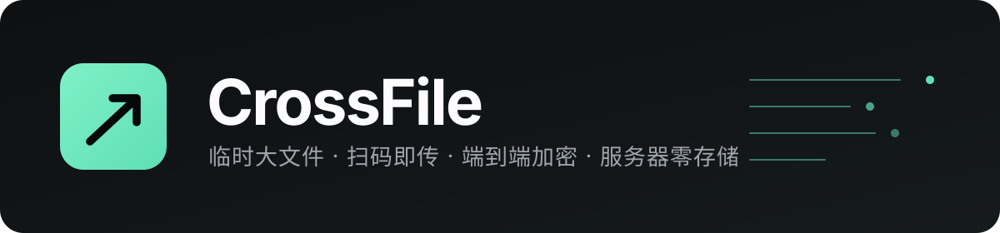

<p align="center">
  
</p>

<p align="center">
  <a href="LICENSE"></a>
  <a href="https://github.com/imlinhanchao/cross-file/releases"></a>
  
  
</p>

<h3 align="center">任意两台设备之间，扫码即传，端到端加密，服务器不存一个字节。</h3>

<p align="center">
  临时文件传输 · 500 MB 级 · 无需安装（Web 端）· Web / 桌面 / Android
</p>

---

## 特性

- **扫码即传，零安装**：接收方打开链接或输入 6 位码即可加入，不需要账号、不需要装 App。
- **端到端加密**：文件在浏览器内用 AES-256-GCM 流式加密，密钥只存在于 URL fragment 或数据通道，服务器不可见。
- **服务器零存储**：不写文件、不写数据库、不记访问日志、不设 cookie；房间与成员表只存在内存，进程退出即消失。
- **房间内任意互传**：管理员 + 成员模型，任意两个成员之间可双向传输；同一对设备串行、不同对可并发。
- **大文件**：默认 64 KiB 分片（可升至 256 KiB），单文件 500 MB 级；断线 60 秒内可重连续传，只补缺失分片。
- **智能选路**：局域网直连 → NAT 打洞直连 → TURN 中继，由 ICE 自动选择，界面显示真实路径与实时速率。
- **双重认证**：QR 链接路径用 roomKey 绑定；6 位码路径用双方比对的 4 个 emoji SAS 防中间人。
- **单二进制服务端**：一个静态 Go 可执行文件同时提供网页、信令 WebSocket 与 TURN 中继，服务器不需要 Node，也不需要独立 coturn。
- **跨平台**：Web（Chrome / Edge / Safari / Firefox）、Windows / macOS（Tauri）、Linux（Electron）、Android（Tauri）。

## 架构

```text
┌──────────────┐        wss://<host>/v1/ws (JSON, protocol v2)        ┌───────────────────────────┐
│  发送方 / A  │ ◄─────────────────────────────────────────────────► │  CrossFile 服务端         │
│  Web/桌面/App│            房间成员表 · 信令转发（内存）              │  Go 单二进制              │
└──────┬───────┘                                                     │  · 静态网页（内嵌）        │
       │                                                             │  · /v1/ws 信令            │
       │  WebRTC DataChannel（DTLS-SCTP，端到端）                     │  · TURN 中继（内嵌）       │
       │  · ctrl：JSON 控制（manifest/accept/bitmap/...）              │  · 无数据库 / 无日志       │
       │  · data：AES-256-GCM 密文分片                                  └───────────────────────────┘
       ▼
┌──────────────┐
│  接收方 / B  │   密钥：roomKey（URL fragment / SAS 确认后经数据通道下发）
└──────────────┘
```

- **信令**：WebSocket `/v1/ws`，协议 v2；服务端只维护内存中的房间/成员表并转发 SDP/ICE，从不接触文件内容。
- **密钥**：`roomKey` 由发起方生成，只出现在 URL fragment 或 6 位码路径的 SAS 确认之后；`sessionKey`/`fileKey` 由 HKDF-SHA256 派生。
- **传输**：每对设备一条 `PeerConnection`，两个数据通道（`ctrl` 控制 + `data` 分片）；分片独立认证，全文件 SHA-256 双向校验。
- **中继**：内嵌 TURN（pion/turn）与信令同进程，使用 coturn 兼容的 REST 临时凭据；仅在 `TURN_URIS` 与 `TURN_SECRET` 都配置时启用。
- **零存储**：服务端不落盘、不记 IP/UA、stdout 仅一行启动信息，由 `tests/audit/zero-storage.sh` 用 strace 审计。

协议细节见 [docs/02-protocol.md](docs/02-protocol.md)，架构决策见 [docs/adr/](docs/adr/)。

## 快速开始

**环境要求**：Node.js ≥ 22、pnpm ≥ 12、Go ≥ 1.23（服务端）；Docker 可选。

```bash
pnpm install
pnpm dev
# 信令（Go 单二进制）: ws://127.0.0.1:8788   Web: http://127.0.0.1:5173
```

打开两个浏览器标签页，一个创建房间、一个扫码/输码加入，即可互传文件。

```bash
pnpm dev:signal            # 只起信令（自动构建 Go 二进制）
pnpm dev:web               # 只起前端
bash apps/signaling-go/build.sh   # 构建服务端单二进制（内嵌网页 + 信令 + TURN）
```

## 部署

### 方式一：Docker（单容器）

```bash
cp infra/.env.example infra/.env   # 填 TURN_SECRET / TURN_URIS / TURN_EXTERNAL_IP
docker compose -f infra/docker-compose.yml up -d --build
```

一个容器即可提供网页、`/v1/ws` 与 TURN；镜像基于 distroless、非 root、只读根文件系统。

### 方式二：单二进制 + systemd（推荐）

```bash
# 从 GitHub Release 下载（x64 / arm64）
gh release download v0.4.1 --pattern 'crossfile-signaling-*-linux-x64.tar.gz' --dir /tmp/cf
mkdir -p /var/www/cross-file && tar -xzf /tmp/cf/*.tar.gz -C /var/www/cross-file

# 配置（示例，完整变量见 docs/self-host.md §12）
cat > /var/www/cross-file/shared/.env <<'ENV'
HOST=127.0.0.1
PORT=8788
MAX_MEMBERS=4
TURN_SECRET=<openssl rand -hex 32>
TURN_URIS=turn:example.com:3478?transport=udp,turn:example.com:3478?transport=tcp
TURN_EXTERNAL_IP=<公网 IPv4>
ENV
```

systemd 单元（反代到 127.0.0.1:8788 即可，示例见 [docs/self-host.md](docs/self-host.md) §12.3）：

```ini
[Service]
ExecStart=/var/www/cross-file/crossfile-signaling
EnvironmentFile=/var/www/cross-file/shared/.env
Restart=always
RestrictAddressFamilies=AF_INET AF_INET6 AF_UNIX AF_NETLINK
```

> `AF_NETLINK` 必需：内嵌 TURN 通过 netlink 枚举网卡，缺失会导致启动失败。

### 方式三：PM2（CI 默认）

release 的 tarball 内含 `ecosystem.config.cjs`（`interpreter: "none"`），CI 用 `pm2 start <release>/ecosystem.config.cjs --update-env` 部署；也可按需改成 systemd（`DEPLOY_MODE=systemd`，省约 80 MB 内存）。

### 发布与持续部署

- GitHub Releases 提供：服务端 tarball / 裸二进制（linux x64、arm64）、Linux AppImage、Windows MSI/EXE、macOS DMG、Android APK，附 `SHA256SUMS`。
- 打 tag 即自动构建全部产物并发布 release，随后自动 dispatch `deploy`：下载 release 资产 → scp → 解压 → 重启（PM2 或 systemd）→ 健康检查 → 切换 `current` 软链。
- 流程与 Secrets 见 [docs/release.md](docs/release.md)。

### 官方实例

**https://file.time-pack.com**（Go 单二进制，内嵌 TURN，无 Node、无 coturn）。

## 桌面与移动端

```bash
# Tauri 桌面（Windows / macOS）
pnpm --filter @crossfile/desktop build

# Linux 桌面（Electron，WebKitGTK 无 WebRTC）
pnpm --filter @crossfile/desktop-electron package:linux

# Android（需要 JDK + Android SDK/NDK）
pnpm --filter @crossfile/mobile android:build:debug
```

桌面与移动壳支持在应用内设置服务器地址（首次启动引导 + 设置页），可指向任意自托管实例。

## 安全与隐私

- 文件内容对服务器与中继不可见；中继只转发 DTLS 密文。
- 服务器可见元数据仅限：成员数、显示名、平台、连接关系、字节量；不落盘、不埋点。
- QR 路径由 `roomKey` 派生的 `proof` 阻止服务器伪造成员；6 位码路径由 4 emoji SAS 防中间人。
- 零存储由 `bash tests/audit/zero-storage.sh` 审计（0 写盘、0 数据库、stdout 仅 1 行）。
- 威胁模型与边界见 [docs/02-protocol.md](docs/02-protocol.md) §2、[docs/security.md](docs/security.md)。

## 项目结构

```text
apps/
  web/               React + Vite 前端（零安装接收）
  signaling-go/      Go 单二进制：内嵌网页 + /v1/ws 信令 + TURN
  desktop/           Tauri 2 桌面壳（Windows / macOS）
  desktop-electron/  Linux 桌面壳（Electron）
  mobile/            Tauri 2 Android 壳
packages/
  core/              协议、加密、分片、WebRTC 封装
  ui/                文案与格式化
infra/               Docker、PM2、反向代理示例
tests/               Playwright e2e 与零存储审计
docs/                设计、协议、ADR、部署与验收文档
```

## 开发与测试

```bash
pnpm gate          # prettier + typecheck + 单测 + 对比度 + 零硬编码色值
pnpm e2e           # Playwright 双浏览器真实传输（默认 10 MB）
pnpm verify        # gate + e2e + 零存储审计（本地完整验收）
(cd apps/signaling-go && go test ./...)   # 服务端单测
```

CI 只跑轻量门禁（typecheck / 单测 / Go 测试 / 零存储），浏览器 e2e 与容器审计在本地执行。

## 文档

| 文档 | 内容 |
|---|---|
| [docs/01-design.md](docs/01-design.md) | 产品定位、已定决策、隐私承诺、验收标准 |
| [docs/02-protocol.md](docs/02-protocol.md) | 信令协议 v2、密钥与加密、分片与续传、零存储约束 |
| [docs/03-roadmap.md](docs/03-roadmap.md) | 仓库结构、技术栈、里程碑、测试矩阵 |
| [docs/04-design-system.md](docs/04-design-system.md) | 设计系统、OKLCH token、无障碍 |
| [docs/self-host.md](docs/self-host.md) | 自托管：Docker、单二进制、PM2/systemd、TURN 验证 |
| [docs/release.md](docs/release.md) | 发布流程、产物、部署模式、回滚 |
| [docs/06-acceptance.md](docs/06-acceptance.md) | 验收记录与实测证据 |
| [docs/adr/](docs/adr/) | 架构决策记录 |
| [docs/desktop.md](docs/desktop.md) / [docs/mobile.md](docs/mobile.md) | 桌面与移动壳 |

## 非目标

云盘、账号体系、好友/群组、文件夹同步、文本剪贴板、无外网局域网、纯邻近传输（BLE / Wi-Fi Direct）、跨会话续传。

## License

[MIT](LICENSE)
